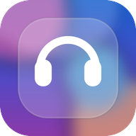
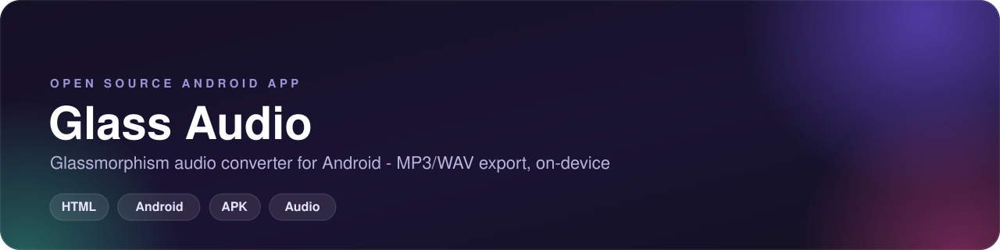
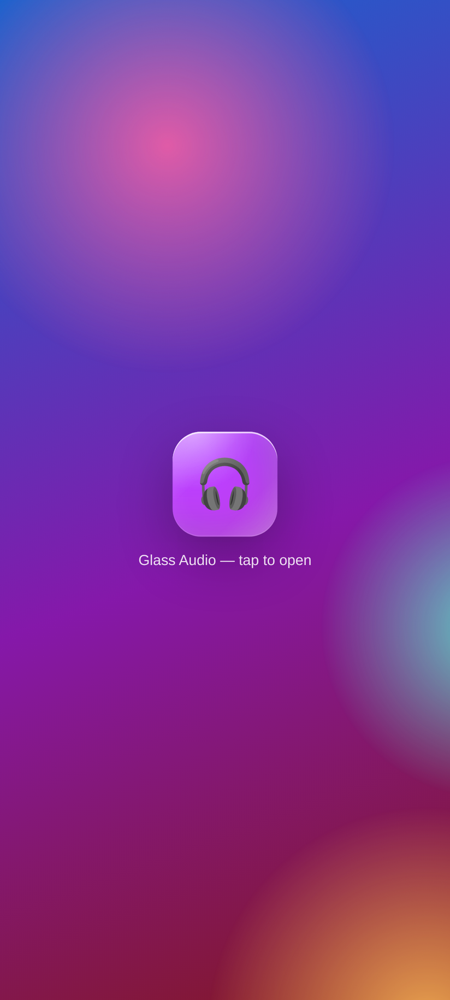
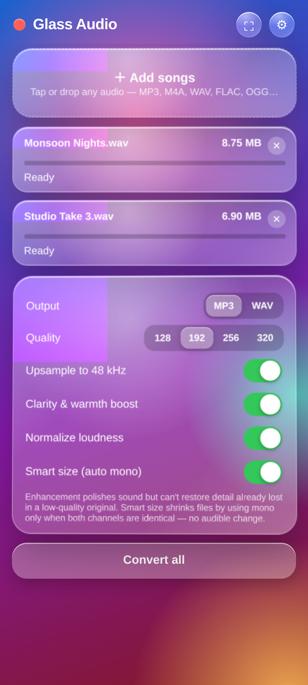
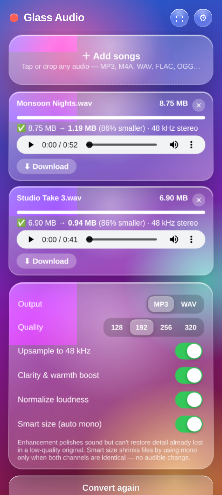
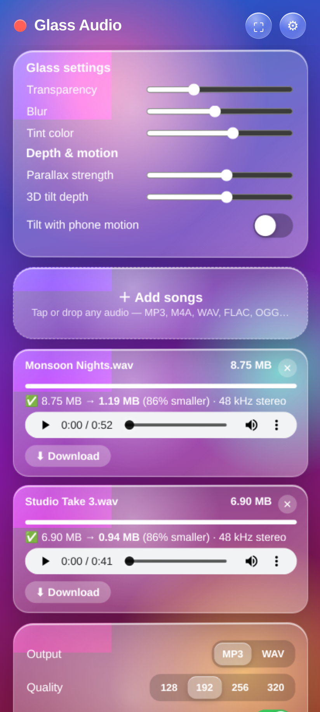
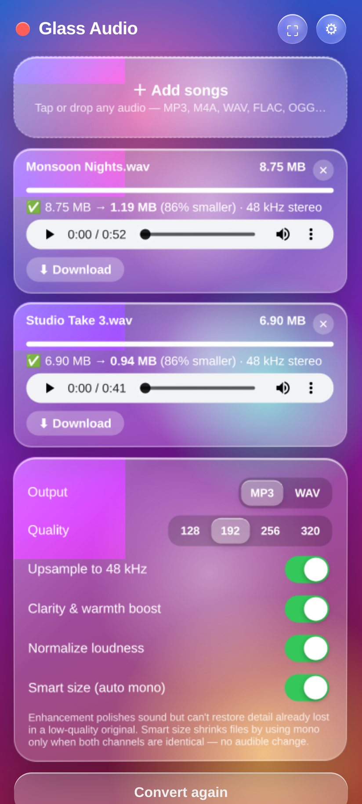

<div align="center">





<a href="https://github.com/technicalnihilist-lgtm/GlassAudio/stargazers"></a>&nbsp;<a href="https://github.com/technicalnihilist-lgtm/GlassAudio/network/members"></a>

<a href="https://github.com/technicalnihilist-lgtm/GlassAudio/releases/latest"></a>

<b>Support the work</b>

  

<sub>Donations aren't live yet — Paytm, UPI, PayPal and Buy&nbsp;Me&nbsp;a&nbsp;Coffee all show <b>coming soon</b>. Until then, a ⭐ star is the best support.</sub>

<a href="https://github.com/technicalnihilist-lgtm/GlassAudio/releases/latest"></a>  <a href="https://github.com/technicalnihilist-lgtm/GlassAudio/releases"></a>

</div>

---

## Screenshots

| | | |
|:--:|:--:|:--:|
|  |  |  |
| Tap the icon to open | Drop in a whole batch | Each track reports its real saving |
|  |  | |
| Glass, blur, tint and tilt are live | Preview and download, one per file | |

All screenshots are real captures of this build: an 8.75 MB WAV converted to a
1.19 MB MP3 (86% smaller) at 192 kbps, 48 kHz stereo.

## Features

- **Any input** the device can decode: MP3, M4A/AAC, WAV, FLAC, OGG, OPUS, AMR.
  Exotic containers fall back to a WebAssembly FFmpeg decoder (needs internet once).
- **MP3 export** at 128 / 192 / 256 / 320 kbps, or **16-bit WAV**.
- **Clarity & warmth boost** — three-stage EQ (low shelf +100 Hz, presence
  +3.5 kHz, air +9 kHz).
- **Loudness normalisation** with a peak-safe ceiling.
- **Upsampling to 48 kHz** for files that come in lower.
- **Smart size** — silently drops to mono only when both channels are identical,
  so it never changes how the file sounds.
- **Batch conversion** — add a folder's worth of files and convert them in one go.
- **Live glass UI** — transparency, blur and tint are adjustable, cards tilt with
  a real parallax depth effect, and the background reacts to your phone's tilt
  (gyroscope) if you enable it.
- Converted files land in **`Music/GlassAudio/`**, visible to every music player.

Everything after the initial download runs offline. No analytics, no accounts,
no network calls except the optional FFmpeg fallback.

## Install

Grab `GlassAudio.apk` from the [Releases](../../releases) page (or build it
yourself below) and open it on the phone. You'll need to allow
"install unknown apps" for whichever app you opened it from.

- Android 7.0 (API 24) or newer
- ~2 MB download, no extra permissions on Android 10+

## Build

You don't need Android Studio or Gradle — `build.sh` drives `aapt2`, `javac`,
`d8`, `zipalign` and `apksigner` directly, which keeps the whole build under a
minute and the repo dependency-free.

```bash
## How it works

```
web/GlassAudio.html        the original single-file web app, untouched
app/assets/www/index.html  the same file, with two lines changed:
                             - lamejs is bundled locally instead of from a CDN
                             - native.js is included for the Android bridge
app/assets/www/native.js   catches blob: downloads and streams them to Java
app/src/.../MainActivity   WebView shell: asset server, file picker, MediaStore
docs/screenshots/          real captures of this build
build.sh                   aapt2 + javac + d8 + zipalign + apksigner
```

Four details make the web app behave like a native one:

1. **A private https origin.** The assets are served from
   `https://appassets.androidplatform.net/` through `shouldInterceptRequest`
   rather than `file://`. That makes the page a *secure context*, which is what
   unlocks Web Audio, `localStorage`, device orientation and the Fullscreen API.
2. **File picking.** `onShowFileChooser` opens the system document picker with
   `EXTRA_ALLOW_MULTIPLE` and audio MIME types, then hands the URIs back to the
   `<input type=file>`.
3. **Saving the output.** A WebView can't download a `blob:` URL, so `native.js`
   intercepts the download link, reads the blob in 3 MB slices and pushes base64
   chunks across the JS bridge. Java reassembles them into a temp file and
   publishes it with `MediaStore` — no storage permission needed on Android 10+.
4. **Fullscreen.** `onShowCustomView` / `onHideCustomView` back the web
   Fullscreen API so the ⛶ button really goes edge to edge.

## Permissions

| Permission | Why |
|---|---|
| `INTERNET` | Only for the optional FFmpeg fallback decoder and the CDN it loads from. Conversion itself is offline. |
| `WRITE_EXTERNAL_STORAGE` | Android 9 and older only, to write into `Music/GlassAudio`. Ignored on 10+. |

## Known limits

- The clarity boost can't restore detail that a low-bitrate original already
  threw away — it shapes what's there.
- MP3 encoding runs on the JS thread; a 5-minute track takes a few seconds and
  the progress bar moves in steps rather than smoothly.
- The FFmpeg fallback for exotic containers needs internet the first time
  (about 25 MB of WebAssembly, cached afterwards).

## Licence

MIT — see [LICENSE](LICENSE). The bundled `lamejs` MP3 encoder is LGPL-3.0.

---

---

## 🌍 Languages

<sub>Donations are <b>coming soon</b> in every language below — nothing to pay today, nothing to click.</sub>

<div align="center">

<sub><b>हिन्दी · বাংলা · मराठी · తెలుగు · தமிழ் · ગુજરાતી · ಕನ್ನಡ · മലയാളം · ਪੰਜਾਬੀ · ଓଡ଼ିଆ · অসমীয়া · اردو</b></sub>

</div>

<details>
<summary><b>🌍 Open the same message in 53 languages</b></summary>

**🇮🇳 Indian languages**

- **हिन्दी** (Hindi) — ☕ जल्द ही आ रहा है। · ⭐ अगर आपको यह ऐप और हमारा काम पसंद है, तो कृपया रिपॉजिटरी को स्टार दें और हमें फॉलो करें।
- **বাংলা** (Bengali) — ☕ খুব শিগগিরই আসছে। · ⭐ যদি আপনার এই অ্যাপ এবং আমাদের কাজ ভালো লাগে, তবে অনুগ্রহ করে রিপোজিটরিটিকে একটি স্টার দিন এবং আমাদের ফলো করুন।
- **मराठी** (Marathi) — ☕ लवकरच येत आहे. · ⭐ जर तुम्हाला हे ॲप आणि आमचं काम आवडलं असेल, तर कृपया रिपॉझिटरीला स्टार द्या आणि आम्हाला फॉलो करा.
- **తెలుగు** (Telugu) — ☕ త్వరలో రాబోతోంది. · ⭐ మీకు ఈ యాప్, మా పని నచ్చితే, దయచేసి రిపోజిటరీకి ఒక స్టార్ ఇచ్చి మమ్మల్ని ఫాలో అవ్వండి.
- **தமிழ்** (Tamil) — ☕ விரைவில் வருகிறது. · ⭐ உங்களுக்கு இந்த ஆப்பும் எங்க வேலையும் பிடிச்சிருந்தா, தயவுசெஞ்சு இந்த ரெபாசிட்டரிக்கு ஒரு ஸ்டார்…
- **ગુજરાતી** (Gujarati) — ☕ ટૂંક સમયમાં આવી રહ્યું છે. · ⭐ જો તમને આ એપ અને અમારું કામ ગમતું હોય, તો પ્લીઝ રિપોઝિટરીને સ્ટાર આપો અને અમને ફોલો કરો.
- **ಕನ್ನಡ** (Kannada) — ☕ ಶೀಘ್ರದಲ್ಲೇ ಬರುತ್ತಿದೆ. · ⭐ ನಿಮಗೆ ಈ ಆ್ಯಪ್ ಮತ್ತು ನಮ್ಮ ಕೆಲಸ ಇಷ್ಟವಾದರೆ, ದಯವಿಟ್ಟು ರೆಪೊಸಿಟರಿಗೆ ಸ್ಟಾರ್ ಕೊಡಿ ಮತ್ತು ನಮ್ಮನ್ನು ಫಾಲೋ ಮಾಡಿ.
- **മലയാളം** (Malayalam) — ☕ ഉടൻ വരുന്നു. · ⭐ നിങ്ങൾക്ക് ഈ ആപ്പും ഞങ്ങളുടെ പ്രവർത്തനവും ഇഷ്ടപ്പെട്ടെങ്കിൽ, ദയവായി റെപ്പോസിറ്ററിക്ക് ഒരു സ്റ്റാർ…
- **ਪੰਜਾਬੀ** (Punjabi) — ☕ ਜਲਦੀ ਆ ਰਿਹਾ ਹੈ। · ⭐ ਜੇ ਤੁਹਾਨੂੰ ਇਹ ਐਪ ਅਤੇ ਸਾਡਾ ਕੰਮ ਪਸੰਦ ਹੈ, ਤਾਂ ਕਿਰਪਾ ਕਰਕੇ ਰਿਪੋਜ਼ਟਰੀ ਨੂੰ ਸਟਾਰ ਦਿਓ ਅਤੇ ਸਾਨੂੰ ਫਾਲੋ ਕਰੋ।
- **ଓଡ଼ିଆ** (Odia) — ☕ ଖୁବ୍ ଶୀଘ୍ର ଆସୁଛି। · ⭐ ଯଦି ଆପଣଙ୍କୁ ଏହି ଆପ୍ ଏବଂ ଆମର କାମ ଭଲ ଲାଗୁଛି, ତେବେ ଦୟାକରି ରିପୋଜିଟୋରୀକୁ ଗୋଟିଏ ଷ୍ଟାର୍ ଦିଅନ୍ତୁ ଏବଂ ଆମକୁ ଫଲୋ କରନ୍ତୁ।
- **অসমীয়া** (Assamese) — ☕ অতি সোনকালেই আহি আছে। · ⭐ যদি আপুনি এই এপটো আৰু আমাৰ কাম ভাল পায়, তেন্তে অনুগ্ৰহ কৰি ৰিপজিটৰীটোক এটা ষ্টাৰ দিয়ক আৰু আমাক ফ'ল' কৰক।
- **اردو** (Urdu) — ☕ جلد آرہا ہے۔ · ⭐ اگر آپ کو یہ ایپ اور ہمارا کام پسند آئے تو براہ کرم ریپازٹری کو سٹار دیں اور ہمیں فالو کریں۔
- **संस्कृतम्** (Sanskrit) — ☕ शीघ्रमेव आगच्छति।
- **मैथिली** (Maithili) — ☕ जल्दिये आबि रहल अछि।
- **कोंकणी** (Konkani) — ☕ रोखडेंच येता.
- **کٲشُر** (Kashmiri) — ☕ جَلدی یِوان چھُ۔
- **سنڌي** (Sindhi) — ☕ जल्द अची रह्यो आहे।
- **डोगरी** (Dogri) — ☕ जल्दी आ करदा ऐ।
- **ꯃꯤꯇꯩ ꯂꯣꯟ** (Manipuri) — ☕ ꯑꯊꯨꯕꯥ ꯃꯇꯝꯗꯥ ꯂꯥꯛꯀꯅꯤ꯫
- **बर’** (Bodo) — ☕ थाबैनो फैगोन।
- **ᱥᱟᱱᱛᱟᱲᱤ** (Santali) — ☕ ᱞᱚᱜᱚᱱ ᱦᱤᱡᱩᱜ ᱠᱟᱱᱟ᱾
- **नेपाली** (Nepali) — ☕ छिट्टै आउँदैछ। · ⭐ यदि तपाईंलाई यो एप र हाम्रो काम मन पर्‍यो भने, कृपया रिपोजिटरीलाई स्टार दिनुहोस् र हामीलाई फलो गर्नुहोस्।

**🌍 World languages**

- **العربية** (Arabic) — ☕ قريبًا. · ⭐ إذا أعجبك هذا التطبيق وعملنا، فيرجى منح المستودع نجمة ومتابعتنا.
- **简体中文** (Chinese (Simplified)) — ☕ 即将推出。
- **繁體中文** (Chinese (Traditional)) — ☕ 即將推出。
- **Čeština** (Czech) — ☕ Již brzy.
- **Dansk** (Danish) — ☕ Kommer snart.
- **Nederlands** (Dutch) — ☕ Binnenkort beschikbaar. · ⭐ Vind je deze app en ons werk leuk?
- **Filipino** (Filipino) — ☕ Malapit na.
- **Suomi** (Finnish) — ☕ Tulossa pian.
- **Français** (French) — ☕ Bientôt disponible. · ⭐ Si cette application et notre travail vous plaisent, mettez une étoile au dépôt et suivez-nous.
- **Deutsch** (German) — ☕ Bald verfügbar. · ⭐ Wenn dir diese App und unsere Arbeit gefallen, gib dem Repository einen Stern und folge uns.
- **Ελληνικά** (Greek) — ☕ Έρχεται σύντομα.
- **עברית** (Hebrew) — ☕ בקרוב.
- **Magyar** (Hungarian) — ☕ Hamarosan.
- **Bahasa Indonesia** (Indonesian) — ☕ Segera hadir. · ⭐ Jika kamu suka aplikasi ini dan karya kami, beri bintang pada repositori ini dan ikuti kami.
- **Italiano** (Italian) — ☕ In arrivo.
- **日本語** (Japanese) — ☕ 近日公開。 · ⭐ このアプリと私たちの仕事が気に入ったら、リポジトリにスターを付けてフォローしてください。
- **한국어** (Korean) — ☕ 곧 공개됩니다. · ⭐ 이 앱과 저희 작업이 마음에 드신다면 저장소에 스타를 눌러 주시고 팔로우해 주세요.
- **Bahasa Melayu** (Malay) — ☕ Akan datang.
- **Norsk** (Norwegian) — ☕ Kommer snart.
- **فارسی** (Persian) — ☕ به‌زودی.
- **Polski** (Polish) — ☕ Wkrótce. · ⭐ Jeśli podoba Ci się ta aplikacja i nasza praca, daj repozytorium gwiazdkę i obserwuj nas.
- **Português** (Portuguese) — ☕ Em breve.
- **Română** (Romanian) — ☕ În curând.
- **Русский** (Russian) — ☕ Скоро. · ⭐ Если вам нравится это приложение и наша работа, поставьте звёздочку репозиторию и подпишитесь на нас.
- **Español** (Spanish) — ☕ Muy pronto. · ⭐ Si te gusta esta app y nuestro trabajo, dale una estrella al repositorio y síguenos.
- **Kiswahili** (Swahili) — ☕ Inakuja hivi karibuni.
- **Svenska** (Swedish) — ☕ Kommer snart.
- **ไทย** (Thai) — ☕ เร็ว ๆ นี้
- **Türkçe** (Turkish) — ☕ Çok yakında.
- **Українська** (Ukrainian) — ☕ Незабаром.
- **Tiếng Việt** (Vietnamese) — ☕ Sắp ra mắt. · ⭐ Nếu bạn thích ứng dụng này và công việc của chúng tôi, hãy tặng kho lưu trữ một ngôi sao và theo…

</details>

